  

building at <a href="https://github.com/pilotworks"><b>@pilotworks</b></a>

| | |
|:--|:--|
| **[scriptgo](https://github.com/pilotworks/scriptgo)** · `C` | Compiles TypeScript into standalone native binaries with Node.js semantics |
| **[patchpilot](https://github.com/phamtanminhtien/patchpilot)** · `Go` | _one-line description_ |
| **[goroute](https://github.com/phamtanminhtien/goroute)** · `Go` | _one-line description_ |
| **[aws-saa-c03](https://github.com/pilotworks/AWS-Certified-Solutions-Architect-Associate-SAA-C03)** · `TS` | Interactive SAA-C03 study hub: diagrams, flashcards, practice exams |

 

<picture>
  <source media="(prefers-color-scheme: dark)" srcset="https://raw.githubusercontent.com/phamtanminhtien/phamtanminhtien/output/snake-dark.svg">
  
</picture>
